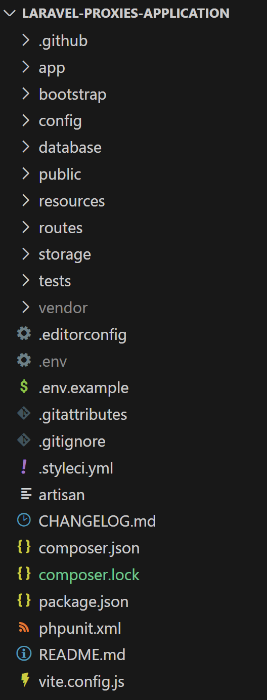
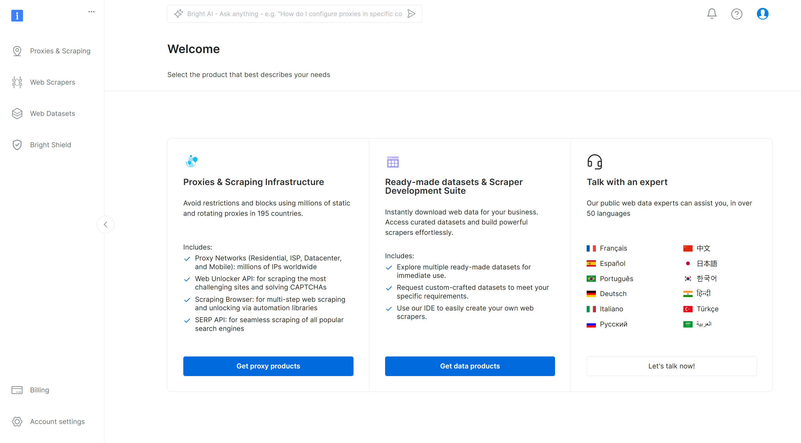
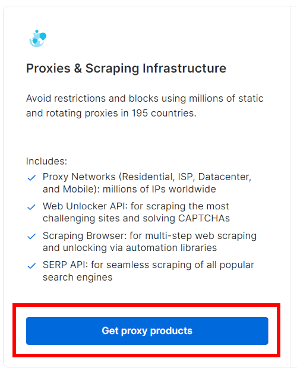
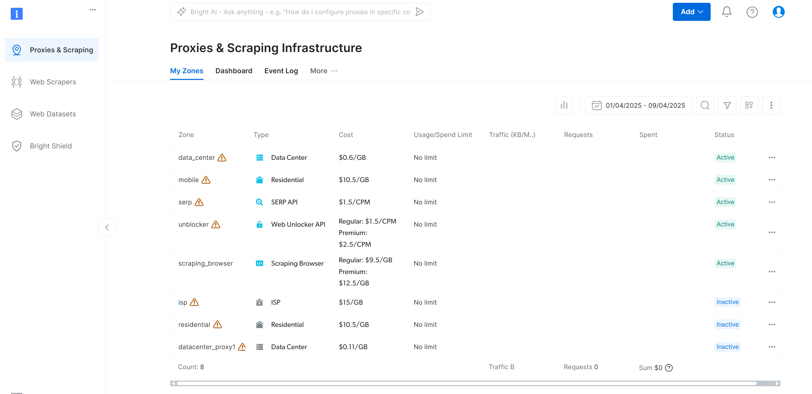
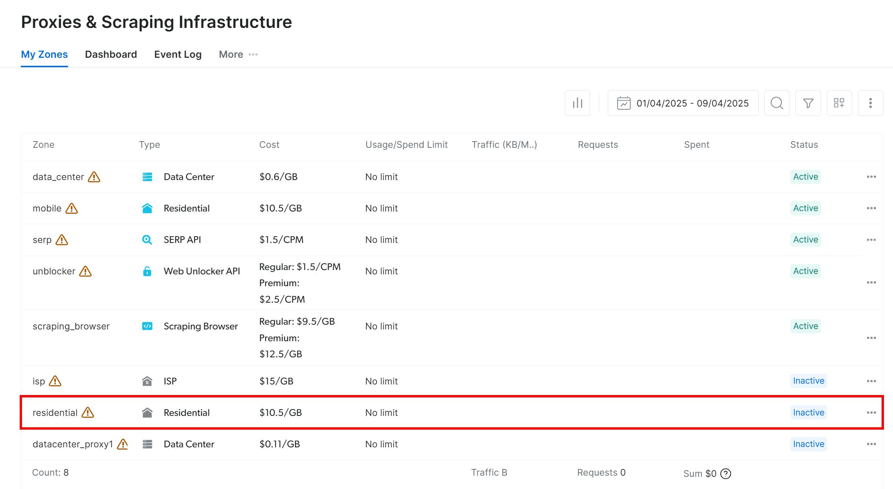
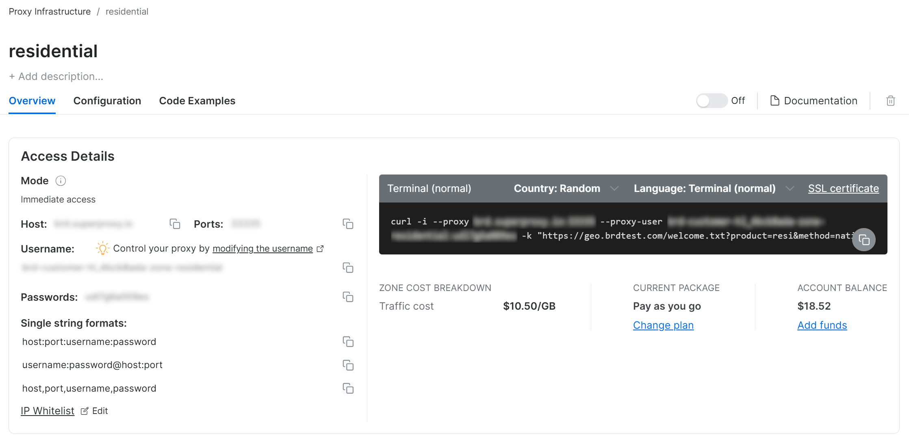
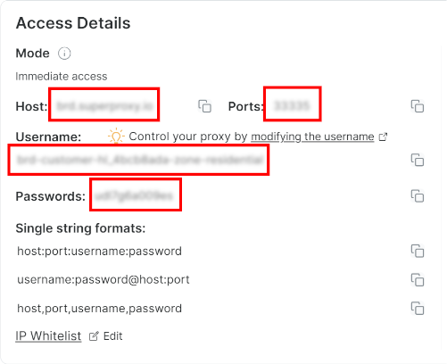
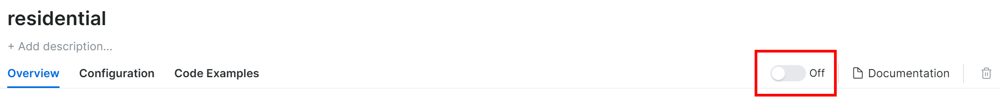

# 在 Laravel 中使用代理

[](https://www.bright.cn/)

本指南介绍如何在 Laravel 项目中配置和实现代理，以进行不受阻碍的网页爬虫和地理访问控制。

- [什么是 Laravel 代理？](#什么是-laravel-代理)
- [代理在 Laravel 中的用例](#代理在-laravel-中的用例)
- [在 Laravel 中使用代理：分步指南](#在-laravel-中使用代理分步指南)
- [高级用例](#高级用例)
- [在 Laravel 中使用 Bright Data 代理](#在-laravel-中使用-bright-data-代理)
- [附加内容：Symfony 的 `HttpClient` 代理集成](#附加内容-symfony-的-httpclient-代理集成)

## 什么是 Laravel 代理？

Laravel 代理充当 Laravel 应用程序与外部服务器之间的中间层。它允许你通过编程方式将服务器流量[经由代理服务器](https://www.bright.cn/blog/proxy-101/what-is-proxy-server)转发，从而隐藏你的 IP 地址。

以下是代理在 Laravel 中的工作方式：

1. Laravel 使用已配置代理的 HTTP 客户端库发起 HTTP 请求。
2. 请求经由代理服务器传输。
3. 代理将请求转发到目标服务器。
4. 目标服务器将响应发送回代理。
5. 代理将响应转发给 Laravel。

因此，目标服务器看到请求来自代理的 IP，而不是 Laravel 服务器的地址。借助这一机制，你可以绕过地理限制、增强匿名性并应对速率限制。

## 代理在 Laravel 中的用例

代理在 Laravel 中有许多用途，以下三种尤为常见：

- **网页爬虫**：在创建网页爬虫工具 API 时使用代理，以防止 IP 被封、绕过速率限制或规避其他限制。有关更多信息，请阅读我们的 [Laravel 网页爬虫教程](https://www.bright.cn/blog/web-data/web-scraping-with-laravel)。
- **绕过第三方 API 的速率限制**：轮换使用代理 IP，以确保不超出 API 使用配额并避免受到限流。
- **访问受地理限制的内容**：选择位于特定地区的代理服务器，以使用仅在特定国家/地区提供的服务。

有关更多示例，请参阅我们的[网页数据和代理用例指南](https://www.bright.cn/use-cases)。

## 在 Laravel 中使用代理：分步指南

在本节中，我们将演示如何使用[默认 HTTP 客户端](https://laravel.com/docs/master/http-client)将代理集成到 Laravel 中。本文后面还将介绍如何与 [Symfony `HttpClient`](https://symfony.com/doc/current/http_client.html) 库集成代理。

> **注意**：
> 
> Laravel 的 HTTP 客户端基于 Guzzle 构建，因此你可能还需要查看我们的 [Guzzle 代理集成指南](https://www.bright.cn/blog/how-tos/proxy-with-guzzle)。

为了演示集成过程，我们将建立一个 `GET` `/api/v1/get-ip` 端点，该端点将：

1. 使用配置的代理向 [`https://httpbin.io/ip`](https://httpbin.io/ip) 发送 `GET` 请求。
2. 从响应中提取出口 IP 地址。
3. 将该 IP 返回给调用 Laravel 端点的客户端。

如果一切配置正确，API 返回的 IP 将与代理的 IP 地址一致。

### 步骤 1：项目设置

如果你已经配置好 Laravel 应用程序，可以直接跳到步骤 2。

否则，请按照以下说明创建新的 Laravel 项目。打开终端并执行以下 Composer [`create-command`](https://getcomposer.org/doc/03-cli.md#create-project)，以初始化一个全新的 Laravel 项目：

```sh
composer create-project laravel/laravel laravel-proxies-application
```

此命令将在名为 `laravel-proxies-application` 的目录中创建一个新的 Laravel 项目。使用你常用的 PHP IDE 打开此文件夹。

此时，该目录应包含标准的 Laravel 文件结构：



### 步骤 2：定义测试 API 端点

在项目目录中执行以下 [Artisan 命令](https://laravel.com/docs/11.x/artisan)，以生成新的控制器：

```sh
php artisan make:controller IPController
```

这将在 `/app/Http/Controllers` 目录中创建名为 `IPController.php` 的文件，其中包含以下默认内容：

```php
<?php

namespace App\Http\Controllers;

use Illuminate\Http\Request;

class IPController extends Controller
{
    //
}
```

现在，将下面的 `getIP()` 方法添加到 `IPController.php`：

```php
public function getIP(): JsonResponse
{
    // make a GET request to the "/ip" endpoint to get the IP of the server
    $response = Http::get('https://httpbin.io/ip'); 

    // retrieve the response data
    $responseData = $response->json();

    // return the response data 
    return response()->json($responseData);
}
```

此方法使用 Laravel 的 `Http` 客户端从 `https://httpbin.io/ip` 获取你的 IP 地址，并以 JSON 格式返回。

请记得添加以下两个 import：

```php
use Illuminate\Http\JsonResponse;
use Illuminate\Support\Facades\Http;
```

由于你希望 Laravel 应用程序提供无状态 API，请使用 [`install:api`](https://laravel.com/docs/master/routing#api-routes) Artisan 命令启用 API 路由：

```sh
php artisan install:api
```

要通过 API 端点公开此方法，请将以下路由添加到 `routes/api.php` 文件：

```php
use App\Http\Controllers\IPController;

Route::get('/v1/get-ip', [IPController::class, 'getIP']);
```

你的新 API 端点可通过以下地址访问：

```php
/api/v1/get-ip
```

**注意**：请记住，默认情况下，所有 Laravel API 都位于 `/api` 路径下。

现在可以测试 `/api/v1/get-ip` 端点了！

运行以下命令启动 Laravel 开发服务器：

```sh
php artisan serve
```

服务器现在应在本地监听 `8000` 端口。

使用 cURL 向 `/api/v1/get-ip` 端点发送 `GET` 请求：

```sh
curl -X GET 'http://localhost:8000/api/v1/get-ip' 
```

**注意**：在 Windows 上，请将 `curl` 替换为 `curl.exe`。更多信息请参阅我们的[如何使用 cURL 发送 GET 请求指南](https://www.bright.cn/faqs/curl/curl-get-requests)。

你应该会收到类似以下内容的响应：

```json
{
  "origin": "45.89.222.18"
}
```

此响应与 HttpBin 的 `/ip` 端点生成的结果完全一致，证明你的 Laravel API 运行正常。具体而言，显示的 IP 地址是你计算机的公网 IP。

### 步骤 3：获取代理

要在 Laravel 应用程序中使用代理，你首先需要有权访问正常运行的代理服务器。

典型的代理 URL 采用以下格式：

```
<protocol>://<host>:<port>
```

其中：

- `protocol` 是连接代理服务器所需的协议（例如 `http`、`https`、`socks5`）
- `host` 是代理服务器的 IP 地址或域名
- `port` 是用于路由流量的端口

在本例中，假设你的代理 URL 为：

```
http://66.29.154.103:3128
```

将其存储在 `getIP()` 方法中的一个变量内：

```php
$proxyUrl = 'http://66.29.154.103:3128';
```

### 步骤 4：在 `Http` 中集成代理

使用 `Http` 客户端将代理集成到 Laravel 中只需少量额外配置：

```php
$proxyUrl = 'http://66.29.154.103:3128';

$response = Http::withOptions([
    'proxy' => $proxyUrl
])->get('https://httpbin.io/ip');

$responseData = $response->json();
```

你需要使用 [`withOptions()`](https://laravel.com/docs/11.x/http-client#guzzle-options) 方法将代理 URL 作为选项传入。这会指示 Laravel 的 HTTP 客户端使用 [Guzzle 的 `proxy` 选项](https://docs.guzzlephp.org/en/stable/request-options.html#proxy)，通过指定的代理服务器路由请求。

### 步骤 5：整合所有内容

集成代理后，最终的 Laravel API 逻辑应如下所示：

```php
<?php

namespace App\Http\Controllers;

use Illuminate\Http\Request;
use Illuminate\Http\JsonResponse;
use Illuminate\Support\Facades\Http;

class IPController extends Controller
{

    public function getIP(): JsonResponse
    {
        // the URL of the proxy server
        $proxyUrl = 'http://66.29.154.103:3128'; // replace with your proxy URL

        // make a GET request to /ip endpoint through the proxy server
        $response = Http::withOptions([
            'proxy' => $proxyUrl
        ])->get('https://httpbin.io/ip');

        // retrieve the response data
        $responseData = $response->json();

        // return the response data
        return response()->json($responseData);
    }
}
```

在本地运行 Laravel 进行测试：

```sh
php artisan serve
```

然后再次连接到 `/api/v1/get-ip` 端点：

```sh
curl -X GET 'http://localhost:8000/api/v1/get-ip' 
```

这一次，输出应类似于：

```json
{
  "origin": "66.29.154.103"
}
```

`"origin"` 字段显示代理服务器的 IP 地址，证明你的真实 IP 现已隐藏在代理之后。

> **警告**：
> 
> 免费代理服务器通常不稳定或存续时间很短。当你尝试此示例时，示例代理可能已无法使用。如有必要，请在测试前将 `$proxyUrl` 替换为当前可用的代理。

如果发送请求时遇到 SSL 错误，请参阅下方高级用例部分提供的故障排除建议。

## 高级用例

你已经掌握了在 Laravel 中集成代理的基础知识，但还有一些高级场景值得了解。

### 代理身份验证

付费代理通常需要身份验证，以确保只有获得授权的用户才能访问。如果没有正确的凭据，你会遇到以下错误：

```
cURL error 56: CONNECT tunnel failed, response 407
```

经过身份验证的代理 URL 通常采用以下格式：

```
<protocol>://<username>:<password>@<host>:<port>
```

其中，`username` 和 `password` 是你的身份验证凭据。

Laravel 的 `Http` 类（底层使用 Guzzle）完全支持经过身份验证的代理。只需稍作修改，直接在代理 URL 中包含身份验证凭据即可：

```php
$proxyUrl = '<protocol>://<username>:<password>@<host>:<port>';
```

例如：

```php
// authenticated proxy with username and password
$proxyUrl = 'http://<username>:<password>@<host>:<port>';

$response = Http::withOptions([
    'proxy' => $proxyUrl
])->get('https://httpbin.io/ip');
```

将 `$proxyUrl` 的值替换为有效且包含身份验证信息的代理 URL。

`Http` 现在会将流量转发到已配置且经过身份验证的代理服务器！

### 避免 SSL 证书问题

使用 Laravel 的 `Http` 客户端配置代理时，你的请求可能会因为类似以下的 SSL 证书验证错误而失败：

```
cURL error 60: SSL certificate problem: self-signed certificate in certificate chain
```

当代理服务器使用自签名 [SSL 证书](https://www.cloudflare.com/learning/ssl/what-is-an-ssl-certificate/)时，通常会发生这种情况。

如果你信任该代理服务器，并且仅在本地或安全环境中进行测试，可以禁用 SSL 验证：

```php
$response = Http::withOptions([
    'proxy' => $proxyUrl,
    'verify' => false, // disable SSL certificate verification
])->get('https://httpbin.io/ip');
```

> **警告**：
> 
> 禁用 SSL 验证会使你容易受到中间人攻击。仅在可信环境中使用此选项。

或者，如果你有[代理服务器的证书文件](https://docs.brightdata.com/general/account/ssl-certificate)（例如 `proxy-ca.crt`），可以使用它进行 SSL 验证：

```php
$response = Http::withOptions([
    'proxy' => $proxyUrl,
    'verify' => storage_path('certs/proxy-ca.crt'), // Path to the CA bundle
])->get('https://httpbin.io/ip');
```

请确保 `proxy-ca.crt` 文件存储在安全且可访问的目录中（例如 `storage/certs/`），并且 Laravel 拥有读取权限。

采用上述任一方法后，代理引起的 SSL 验证错误都应得到解决。

### 代理轮换

如果重复使用同一台代理服务器，目标网站最终很可能会检测并封禁该代理的 IP 地址。为防止这种情况，你可以[轮换代理服务器](https://www.bright.cn/blog/how-tos/how-to-rotate-an-ip-address)，即为每个请求使用不同的代理。

在 Laravel 中轮换代理的步骤如下：

1. 创建一个包含多个代理 URL 的数组
2. 在每次请求前随机选择一个
3. 在 HTTP 客户端配置中设置所选代理

使用以下代码实现：

```php
<?php

namespace App\Http\Controllers;

use Illuminate\Http\Request;
use Illuminate\Http\JsonResponse;
use Illuminate\Support\Facades\Http;

function getRandomProxyUrl(): string
{
    // a list of valid proxy URLs (replace with your proxy URLs)
    $proxies = [
        '<protocol_1>://<proxy_host_1>:<port_1>', 
        // ...
        '<protocol_n>://<proxy_host_n>:<port_n>',
    ];

    // return a proxy URL randomly picked from the list
    return $proxies[array_rand($proxies)];
}

class IPController extends Controller
{
    public function getIP(): JsonResponse
    {
        // the URL of the proxy server
        $proxyUrl = getRandomProxyUrl();
        // make a GET request to /ip endpoint through the proxy server
        $response = Http::withOptions([
            'proxy' => $proxyUrl
        ])->get('https://httpbin.io/ip');

        // retrieve the response data
        $responseData = $response->json();

        // return the response data
        return response()->json($responseData);
    }
}
```

此代码片段演示了如何从列表中随机选择代理，以实现代理轮换。虽然这种方法有效，但也存在局限性：

1. 你必须维护一组可靠的代理服务器，而这通常需要付费。
2. 要实现有效轮换，代理池必须足够大。如果代理数量不足，将重复使用相同的服务器，可能导致被检测和封禁。

要克服这些难题，可以考虑使用 [Bright Data 的动态代理网络](https://www.bright.cn/solutions/rotating-proxies)。

## 在 Laravel 中使用 Bright Data 代理

按照以下步骤在 Laravel 中使用 Bright Data 的住宅代理。

如果你还没有账户，请[注册 Bright Data](https://www.bright.cn/cp/start)。如果已有账户，请登录并访问用户控制面板：



登录后，点击“获取代理产品”按钮：



你将进入“代理和抓取基础设施”页面：



在表格中找到“住宅代理”行并点击：



你将进入住宅代理页面：



首次使用时，请按照设置向导根据你的要求配置代理服务。如需更多帮助，可随时[联系其全天候支持团队](https://www.bright.cn/contact)。

在“概览”选项卡中，找到代理的主机、端口、用户名和密码：



使用这些信息构建代理 URL：

```php
$proxyUrl = 'http://<brightdata_proxy_username>:<brightdata_proxy_password>@<brightdata_proxy_host>:<brightdata_proxy_port>';
```

将占位符（`<brightdata_proxy_username>`、`<brightdata_proxy_password>`、`<brightdata_proxy_host>`、`<brightdata_proxy_port>`）替换为你的实际代理凭据。

请务必切换“关闭”开关以启用代理产品，并完成其余设置说明：



配置代理 URL 后，你现在可以使用 `Http` 客户端将其集成到 Laravel 中。以下是在 Laravel 中通过 Bright Data 动态住宅代理发送请求的代码：

```php
public function getIp()
{
    // TODO: replace the placeholders with your Bright Data's proxy info
    $proxyUrl = 'http://<brightdata_proxy_username>:<brightdata_proxy_password>@<brightdata_proxy_host>:<brightdata_proxy_port>';

    // make a GET request to "/ip" through the proxy
    $response = Http::withOptions([
        'proxy' => $proxyUrl,
    ])->get('https://httpbin.org/ip');

    // get the response data
    $responseData = $response->json();

    return response()->json($responseData);
}
```

每次执行此脚本时，你都会看到不同的出口 IP。

## [附加内容] Symfony 的 `HttpClient` 代理集成

如果相比 Laravel 的默认 HTTP 客户端 `Http`，你更倾向于使用 Symfony 的 `HttpClient` 组件，请按照以下说明在 Laravel 中通过 `HttpClient` 实现代理集成。

首先，通过 Composer 安装 Symfony HTTP 客户端包：

```sh
composer require symfony/http-client
```

接下来，你可以按以下方式将 Symfony 的 `HttpClient` 与代理搭配使用：

```php
<?php

namespace App\Http\Controllers;

use Symfony\Contracts\HttpClient\HttpClientInterface;
use Illuminate\Http\JsonResponse;

class IpController extends Controller
{
    // where to store the HttpClient instance
    private $client;

    public function __construct(HttpClientInterface $client)
    {
        // initialize the HttpClient private instance
        $this->client = $client;
    }

    public function getIp(): JsonResponse
    {
          // your proxy URL
          $proxyUrl = 'http://66.29.154.103:3128'; // replace with your proxy URL

          // make a GET request to the "/ip" endpoint through the proxy
          $response = $this->client->request('GET', 'https://httpbin.io/ip', [
              'proxy' => $proxyUrl,
          ]);

          // parse the response JSON and return it
          $responseData = $response->toArray();
          return response()->json($responseData);
    }
}
```

此配置允许你使用 Symfony 的 `HttpClient` 通过代理发送请求。

## 总结

免费代理服务可能不可靠，并且存在潜在风险。要获得稳定的性能、安全性和可扩展性，你需要值得信赖的代理提供商。选择[市场领先的代理提供商](https://www.bright.cn/blog/proxy-101/best-proxy-providers) Bright Data，节省时间和精力。

立即创建账户，开始免费测试我们的代理！
